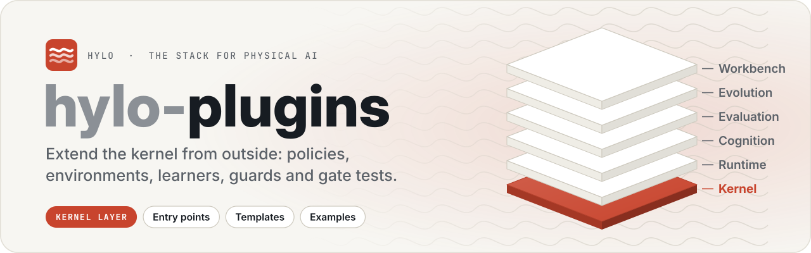
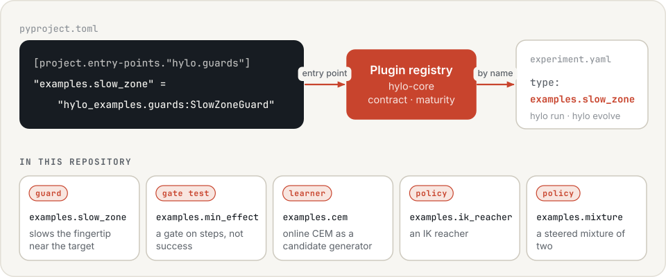
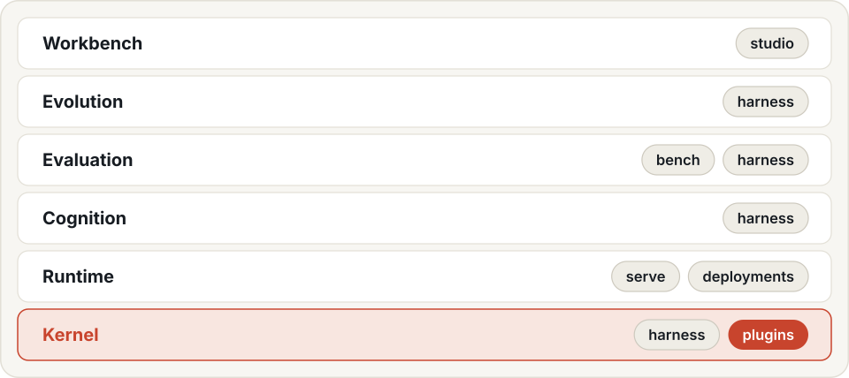

<p align="center">
  <picture>
    <source media="(prefers-color-scheme: dark)" srcset=".github/assets/banner-dark.svg">
    
  </picture>
</p>

<p align="center">
  <a href="LICENSE"></a>
  
  
  
</p>

<p align="center">
  <a href="https://hyloai.github.io/"><b>Website</b></a> ·
  <a href="https://hyloai.github.io/hylo-docs/"><b>Docs</b></a> ·
  <a href="https://hyloai.github.io/hylo-docs/getting-started/quickstart/"><b>Quickstart</b></a> ·
  <a href="https://github.com/HyloAI"><b>All repositories</b></a>
</p>

Part of [Hylo](https://hyloai.github.io/), the stack for physical AI. Plugins extend the **kernel** layer:
policies, environments, learners, guards and gate tests, each registered through an entry point.

Plugins written the way a third party would: separate packages that register entry points and never modify the
harness. They show that each extension point can be used from outside, and serve as templates.

The same extension contracts support the [robot-skill lifecycle](https://hyloai.github.io/hylo-docs/user-guide/skills/):
an agent can use robot tools, and a generator can
propose program candidates for evaluation. Register implementations through the harness's entry points and keep
robot and artifact formats in core contracts. The [development guide](https://hyloai.github.io/hylo-docs/user-guide/developing-strategies/)
shows how these capabilities fit together; the examples here demonstrate the extension mechanism.

<p align="center">
  <picture>
    <source media="(prefers-color-scheme: dark)" srcset=".github/assets/flow-dark.svg">
    
  </picture>
</p>

| Package | Plugins |
|---|---|
| `packages/hylo-plugin-examples` (`hylo_examples`) | `examples.slow_zone` (guard), `examples.min_effect` (gate test), `examples.cem` (online learner), `examples.ik_reacher` and `examples.mixture` (policies) |

```bash
uv run hylo run examples/configs/mujoco_guarded.yaml            # a guard that slows the fingertip near the target
uv run hylo evolve run examples/evolve/mujoco_steps_gate.yaml   # a gate on steps instead of success
uv run hylo evolve run examples/evolve/mujoco_online_cem.yaml   # an online learner as a candidate generator
uv run hylo run examples/configs/mujoco_mixture.yaml            # a steered mixture of two policies
uv run hylo plugin new policy my-policy --dir packages        # a new plugin package from a template
uv run python examples/01_plugin_effects.py                 # each plugin with and without, measured (examples/README.md)
```

The examples run on MuJoCo planar reach, so they need hylo-bench (hylo-env-mujoco) installed next to the
harness; the unit tests use the harness's test double. Run from this repository. The extension points, their contracts and conformance checks: the harness's
docs/extending.md.

Documentation (hylo-docs, `uv run mkdocs serve -f docs/mkdocs.yml` from the workspace): [extending](../harness/docs/extending.md) (also on the site), the plugin catalogue (generated from `hylo plugins`).

## The Hylo stack

<p align="center">
  <picture>
    <source media="(prefers-color-scheme: dark)" srcset=".github/assets/stack-dark.svg">
    
  </picture>
</p>

## License

Apache License 2.0 (see [LICENSE](LICENSE)). Copyright 2026 Hylo AI.
