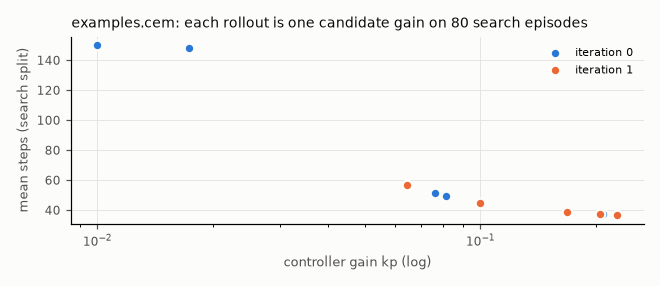

# Plugin examples

Configs and campaigns that use the example plugins of `packages/hylo-plugin-examples`, and one script that measures
what each plugin changes against a run without it. Everything runs on MuJoCo planar reach, so hylo-bench
(hylo-env-mujoco) must be in the workspace. Run from the plugins repository root.

```bash
uv run hylo run examples/configs/mujoco_guarded.yaml              # each config / campaign on its own
uv run hylo evolve run examples/evolve/mujoco_online_cem.yaml
uv run python examples/01_plugin_effects.py [--quick] [--out DIR]  # every plugin with and without, one table each
```

`01_plugin_effects.py` writes `runs/examples/plugin-effects/result.json` and `cem.png`. Its comparisons with
`mujoco-reach` use bench's protocol (100 held-out episodes). The others use the configs' validation split
(20 episodes).

## Results

Measured on 2026-11-01, 128-core CPU, no GPU. Runs are deterministic: a rerun gives the same numbers.

| Example | What it shows | Command | Measured result | Runtime |
|---|---|---|---|---|
| `configs/mujoco_reach.yaml` | the baseline the others build on: the IK controller (kp 0.3) | `uv run hylo run examples/configs/mujoco_reach.yaml` | success 1.00, 35.3 steps, 0 interventions (20 episodes) | < 1 s |
| `configs/mujoco_guarded.yaml` | guard `examples.slow_zone`: the fingertip slows to 25% within 10 cm of the fixed target | `uv run hylo run examples/configs/mujoco_guarded.yaml` | success 1.00, 52.2 steps, 35.2 interventions/episode. Against no guards (`01_plugin_effects.py`): mean fingertip speed in the zone 0.242 -> 0.052 m/s (max 0.463 -> 0.351), 6.6 -> 35.3 steps spent in the zone, episodes 35.2 -> 52.2 steps. Per episode, slow_zone fires 17.7 times, norm_limit 17.5 (also without the zone), and the shield's delta_limit 15.0, because each scaled action jumps from the previous one by more than `max_delta: 0.5` | < 1 s |
| `configs/mujoco_mixture.yaml` | policies `examples.ik_reacher` + `examples.mixture`: 4 seeded samples from two members, medoid executed | `uv run hylo run examples/configs/mujoco_mixture.yaml` | success 1.00, 37.0 steps (20 episodes). Under mujoco-reach every variant succeeds 100/100, so the effect shows in steps: member A (gain 0.3, noise 0.05) 36.6, member B (gain 0.1, noise 0.3) 47.7, A steered 36.4, B steered 46.1, mixture steered 38.0, mixture in mean mode 40.0. The steered mixture takes fewer steps than B in 100 of 100 episodes (sign test p = 8e-31) but more than A (A fewer in 54, mixture fewer in 5): it does not beat its better member | < 1 s |
| `evolve/mujoco_steps_gate.yaml` | the gate's statistic is a plugin (`sign` on steps); both gains always succeed | `uv run hylo evolve run examples/evolve/mujoco_steps_gate.yaml` | kp 0.1 -> 0.2 promoted: fewer steps in 40 of 40 gate pairs, p = 9.1e-13. The same campaign with `mcnemar` or `examples.min_effect` archives the candidate (0 discordant pairs on success) | 4 s |
| gate test `examples.min_effect` | McNemar promotes a real but small gain; min_effect also requires a net win rate | `uv run python examples/01_plugin_effects.py` | IK kp 0.0265 vs 0.025 under mujoco-reach: 95 vs 87%, 8–0 discordant, net effect 0.08. mcnemar p = 0.0039 (passes); min_effect 0.1: p reported as 1 (blocked); min_effect 0.05: p = 0.0039 (passes) | in the script |
| `evolve/mujoco_online_cem.yaml` | online learner `examples.cem` as a candidate generator | `uv run hylo evolve run examples/evolve/mujoco_online_cem.yaml` | 10 rollouts of 80 search episodes over 2 iterations: CEM converged before the configured 3. Search success at kp 0.01 / 0.017 was 0.00 / 0.17, and 1.00 from kp 0.064 up. Best kp 0.228 (mean 36.6 steps). Gate on unseen init states: 1.00 vs parent (kp 0.02) 0.35, 26–0, p = 1.5e-8, promoted; held-out (report only) 1.00 vs 0.40 | 22 s |
| `01_plugin_effects.py` | all of the above, with and without each plugin, in one run | `uv run python examples/01_plugin_effects.py` | the numbers in the rows above | 46 s (quick 38 s, without the three gate campaigns) |
| `hylo plugin new` + `check` | scaffold a policy plugin and check it without installing it | `uv run hylo plugin new policy my-policy --dir /tmp/p` | package created in 0.2 s. Its 2 template tests pass (`PYTHONPATH=/tmp/p/hylo-plugin-my-policy/src uv run pytest /tmp/p/hylo-plugin-my-policy/tests`). `hylo plugin check policy wc_my_policy.plugin:MyPolicyPolicy` passes 4 of 4 checks. The check by entry-point name (`my-policy`) needs `uv pip install -e` first | < 1 s |

`hylo plugin check` on the shipped plugins also passes: `examples.slow_zone` (guard, 4 checks),
`examples.min_effect` (gate test: type-I 0.025, power 0.81 at 40 pairs), `examples.ik_reacher` and
`examples.mixture` (policy, 4 checks each), `examples.cem` (online learner, 4 checks, about 8 s). The online
learner check needs `--params` with a `space`, for example
`--params '{"space": {"kp": {"path": "params.kp", "low": 0.01, "high": 1.0}}, "population": 4, "iterations": 2}'`.
Without it, the check fails with `KeyError: 'space'`.


